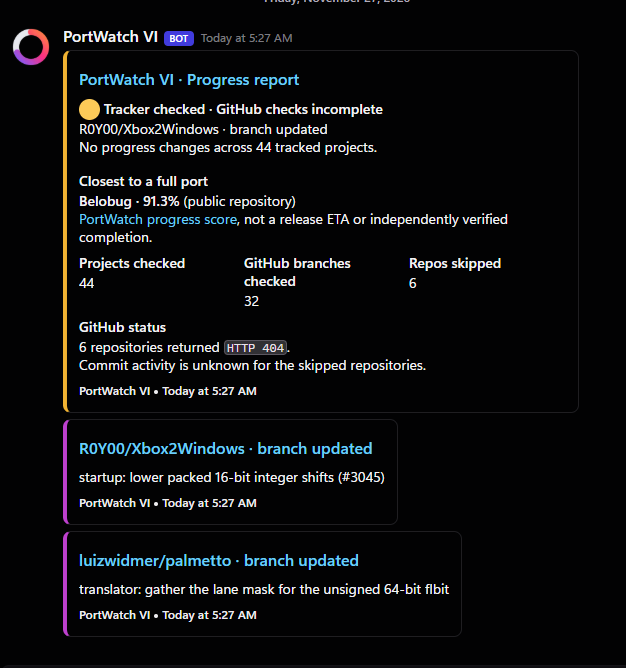
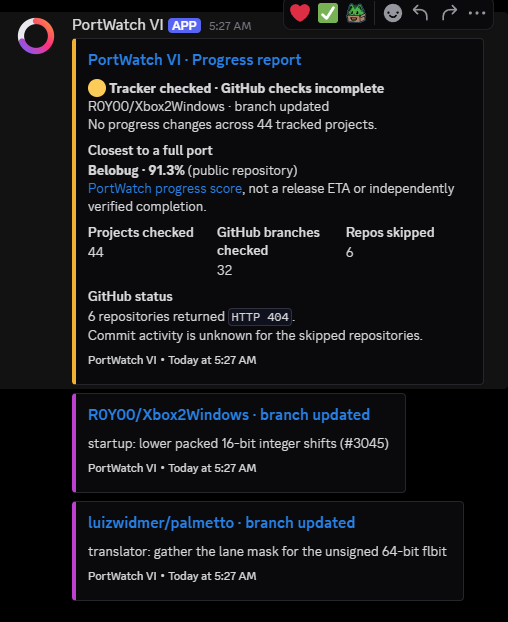

# PortwatchTracker

Watch PortWatch VI tracker and GitHub branch changes and deliver them to Discord and/or Fluxer.
Requires Python 3.9+ on Windows or Linux.

* **Discord:** [Join the Discord server](https://discord.gg/4FGKx86Yx)
* **Fluxer:** [Join the Fluxer server](https://fluxer.gg/YXWFI4j8)

| Fluxer | Discord |
| :---: | :---: |
|  |  |

---

## Overview

Install dependencies: `python -m pip install -r requirements.txt`.
Set `DISCORD_WEBHOOK_URL` and/or `FLUXER_WEBHOOK_URL` in `.env` beside `portwatch.py`. Optional settings:
`SITE` (defaults to https://portwatch-vi.xyz, including when blank),
`WATCH_REPOS` (comma-separated owner/repo allowlist), and `GITHUB_TOKEN`.

Run `python portwatch.py` to check immediately and every three hours while running.
Use `python portwatch.py --once` for a single check and delivery, or
`python portwatch.py --dry-run` to check without sending or saving changes.
In the existing WSL environment, use `.venv/bin/python portwatch.py`.
Stop with Ctrl+C. The process must stay running for scheduled checks.

Every check sends a status embed, including the first baseline, unchanged checks,
and feed failures. Changes also produce individual notifications. Status embeds
include three inline counts for projects, GitHub branches, and skipped repositories.
Incomplete checks lead with "Tracker checked · GitHub checks incomplete" and use
amber. Completed unchanged checks are gray; updates are purple and lead with the
actual change. Identical GitHub errors are grouped; repository details stay in the
console. Clickable titles open PortWatch, and native timestamps show local
time (the original check time is preserved through queue retries).

The main field highlights the active project closest to a full port, using
PortWatch's published `assets/js/scoring.js` model: milestone ladder to 50%, then
story, rendering, FPS, and stability to 100%, with manual score overrides honored.
Projects marked `nuked` are excluded. Private builds are included and labeled,
matching the site's overall headline; `WATCH_REPOS` limits this to watched projects.
This is a PortWatch progress score, not a release ETA or independently verified
completion. The scoring model was inspected on 2026-11-26.

Confirmed DMCA-block counts appear only when nonzero for the current check.
Only an explicit GitHub HTTP 451 response with `block.reason=dmca` counts as a
confirmed DMCA block. Other errors remain skipped checks; no claimant is inferred.
If a webhook target is unavailable, reports remain queued for retry.
Notifications use the name PortWatch VI. The
webhook's configured avatar is used for each notification. Failed deliveries
stay in the SQLite queue and retry on the next run/check. Keep the database beside
the script to preserve history. A crash after a webhook accepts a message but before
the queue is updated—or a partial failure when multiple webhooks are configured—may
cause that message to be delivered again.

## Beginner Setup Guide

Follow these steps to run `portwatch.py` and send notifications to Discord, Fluxer, or both.

### 1. Prepare the Project Folder
* Place `portwatch.py` and `requirements.txt` in the same folder.
* Keep `portwatch.sqlite3` and `portwatch.lock` in that same folder so snapshots and queued messages persist across runs.

### 2. Install Python Dependencies
* Open a terminal or command prompt in the project folder.
* On Windows or standard Linux, run:
  ```bash
  python -m pip install -r requirements.txt
  ```
* In WSL using the project virtual environment, run:
  ```bash
  .venv/bin/python -m pip install -r requirements.txt
  ```

### 3. Configure `.env`
* Create a `.env` file in the same folder as `portwatch.py`.
* Add at least one webhook URL (`DISCORD_WEBHOOK_URL` and/or `FLUXER_WEBHOOK_URL`):
  ```env
  DISCORD_WEBHOOK_URL=https://discord.com/api/webhooks/...
  FLUXER_WEBHOOK_URL=https://api.fluxer.app/webhooks/...
  ```
* Add optional variables only if needed:
  * `SITE`: Overrides the tracker URL (defaults to `https://portwatch-vi.xyz`).
  * `WATCH_REPOS`: Comma-separated `owner/repo` list (for example, `org/repo-one,org/repo-two`) to filter tracked repos.
  * `GITHUB_TOKEN`: Personal access token to increase GitHub API rate limits.

### 4. Test Before Continuous Monitoring
* Run a dry run first to verify feed fetching and parsing without writing to SQLite or sending messages:
  ```bash
  python portwatch.py --dry-run
  ```
* Run a single live check to record the initial baseline and deliver the first report:
  ```bash
  python portwatch.py --once
  ```

### 5. Run the Watcher
* Start continuous monitoring (press `Ctrl+C` to stop):
  ```bash
  python portwatch.py
  ```
* In WSL with `.venv`, run `.venv/bin/python portwatch.py` instead.